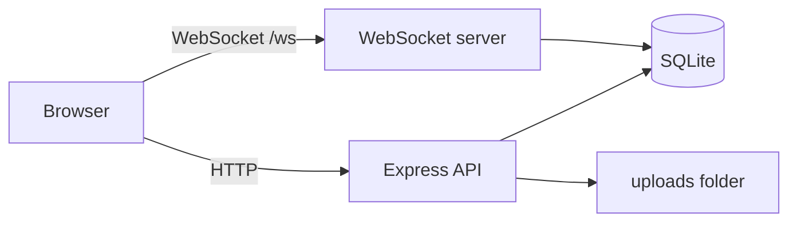

# Realtime Chat

A Telegram-style messaging app built from scratch with Node.js, WebSockets and SQLite. It supports private chats, group chats, file sharing and a responsive UI that works on desktop and mobile.

## Features

- **Accounts:** sign up and log in with bcrypt-hashed passwords and JWT sessions
- **Real-time messaging** over WebSockets with online/offline presence
- **Private chats** with typing indicators, message times and read receipts (single and double ticks)
- **Group chats** with member lists, sender names and unread counters
- **File sharing:** photos, videos and documents up to 20 MB, with inline image and video preview
- **Responsive UI** with dark mode and a mobile layout
- **Message history** stored in SQLite and restored on login

## Security

- Passwords hashed with bcrypt; JWT secret kept in `.env` (auto-generated on first run)
- Rate limiting on login, sign-up and uploads; limits on message size and send rate
- Uploaded files are only served to members of the chat they were sent in
- Executable and script file types are rejected; non-media files are forced to download
- Input validation on usernames, passwords and payload sizes
- All user content is rendered as text, never as HTML

## Architecture



One Node.js process serves the web page, the REST API (auth and uploads) and the WebSocket server on the same port.

| File | Purpose |
| --- | --- |
| `api.js` | Express server: auth, uploads, protected file downloads, serves the page |
| `server.js` | WebSocket logic: presence, private and group messages, typing, read receipts |
| `db.js` | SQLite schema and setup |
| `config.js` | Loads the secret key from `.env` |
| `index.html` | Single-page client |

## Getting started

Requires Node.js 22 or newer.

```bash
git clone https://github.com/bakar-0314/realtime-chat.git
cd realtime-chat
npm install
node api.js
```

Open http://localhost:3000. A `.env` file with a random `JWT_SECRET` is created on the first run. See `.env.example` for the format.

## Roadmap

- [ ] Migrate to TypeScript
- [ ] Automated tests and CI with GitHub Actions
- [ ] PostgreSQL and Redis, packaged with Docker
- [ ] Horizontal scaling with Redis pub/sub and load testing
- [ ] End-to-end encryption
- [ ] Reliable delivery (acknowledgements, retries, offline sync)
- [ ] Cloud deployment with monitoring
