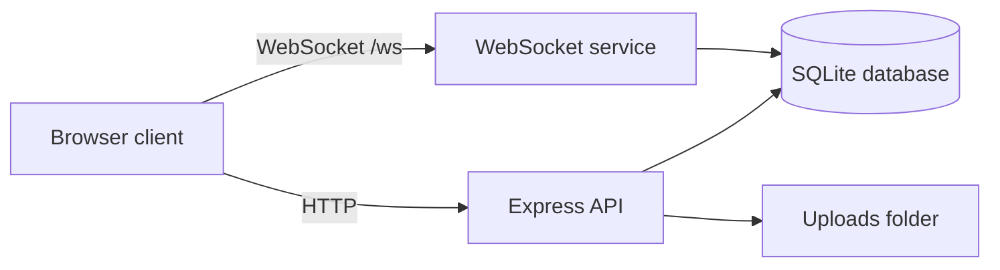

# Software Requirements Specification

**Project:** Realtime Chat
**Version:** 1.0
**Author:** bakar-0314
**Repository:** https://github.com/bakar-0314/realtime-chat
**Status:** Living document, updated as the project evolves

---

## Table of Contents

1. [Introduction](#1-introduction)
2. [Overall Description](#2-overall-description)
3. [Functional Requirements](#3-functional-requirements)
4. [External Interface Requirements](#4-external-interface-requirements)
5. [Non-Functional Requirements](#5-non-functional-requirements)
6. [Data Requirements](#6-data-requirements)
7. [Future Enhancements](#7-future-enhancements)
8. [Requirement Status Summary](#8-requirement-status-summary)

---

## 1. Introduction

### 1.1 Purpose

This document specifies the requirements of **Realtime Chat**, a web-based messaging platform inspired by Telegram. It describes what the system does, the constraints it operates under, and the quality attributes it must meet. It is intended for developers, reviewers and anyone evaluating or extending the project.

### 1.2 Scope

Realtime Chat lets registered users exchange messages instantly through private conversations and group chats. Users can share text, images, videos and documents, see who is online, see when someone is typing, and see when their private messages have been read. Message history is stored and restored when the user logs in again.

The system consists of a single Node.js server that serves a responsive web client, a REST API for authentication and file handling, and a WebSocket service for real-time communication.

**Out of scope for version 1.0:** voice and video calls, native mobile apps, end-to-end encryption, push notifications, and message editing or deletion (see [Future Enhancements](#7-future-enhancements)).

### 1.3 Definitions and Abbreviations

| Term | Meaning |
| --- | --- |
| API | Application Programming Interface |
| JWT | JSON Web Token, a signed token used to identify a logged-in user |
| WebSocket | A persistent two-way connection between browser and server |
| Presence | Whether a user is currently online |
| Rate limiting | Restricting how often an action can be performed |
| SRS | Software Requirements Specification |
| WAL | Write-Ahead Logging, a SQLite journaling mode |

### 1.4 Document Conventions

Requirements are identified as **FR-n** (functional) and **NFR-n** (non-functional). The keyword **shall** marks a mandatory requirement. Each requirement has a status of **Implemented** or **Planned**.

### 1.5 References

- IEEE Std 830-1998, Recommended Practice for Software Requirements Specifications
- RFC 6455, The WebSocket Protocol
- RFC 7519, JSON Web Token (JWT)

---

## 2. Overall Description

### 2.1 Product Perspective

Realtime Chat is a self-contained system. A browser client connects to one Node.js server over HTTP and WebSocket. The server stores data in a SQLite database and uploaded files on its local disk.

### 2.2 Product Functions

- Account registration and login
- Online and offline presence
- Private one-to-one messaging
- Group creation and group messaging
- File sharing (images, videos, documents)
- Typing indicators
- Read receipts for private messages
- Persistent message history and unread counters
- Responsive interface with light and dark themes

### 2.3 User Classes

| User class | Description |
| --- | --- |
| Registered user | Signs up, logs in, chats privately, creates and joins groups, shares files. This is the only user class in version 1.0. |
| Administrator / operator | Runs and configures the server. Not a role inside the application. |

### 2.4 Operating Environment

- **Server:** Node.js 22 or newer on Windows, macOS or Linux
- **Client:** current versions of Chrome, Edge, Firefox and Safari, on desktop and mobile
- **Network:** HTTP and WebSocket connectivity between client and server

### 2.5 Design and Implementation Constraints

- Data is stored in SQLite using Node's built-in `node:sqlite` module.
- Uploaded files are stored on the server's local disk, so the server needs persistent storage.
- The `JWT_SECRET` value must be provided through the environment or a `.env` file and must never be committed to the repository.
- In-memory rate limiting means limits are per server process and reset on restart.

### 2.6 Assumptions and Dependencies

- Users have a modern browser with JavaScript enabled.
- The server is placed behind HTTPS (for example a reverse proxy or tunnel) when exposed to the internet.
- Runtime dependencies: Express, ws, bcryptjs, jsonwebtoken, cors.

---

## 3. Functional Requirements

### 3.1 Authentication and Accounts

| ID | Requirement | Status |
| --- | --- | --- |
| FR-1 | The system shall allow a visitor to create an account with a username and password. | Implemented |
| FR-2 | Usernames shall be 3 to 20 characters long and contain only letters, numbers and underscores. | Implemented |
| FR-3 | Usernames shall be unique, ignoring letter case. | Implemented |
| FR-4 | Passwords for new accounts shall be 8 to 72 characters long. | Implemented |
| FR-5 | Passwords shall be stored only as bcrypt hashes and never in plain text. | Implemented |
| FR-6 | The system shall allow a registered user to log in and shall issue a signed JWT valid for 7 days. | Implemented |
| FR-7 | The client shall keep the user logged in for the browser tab session and shall allow explicit log out. | Implemented |
| FR-8 | An expired or invalid token shall result in the user being asked to log in again. | Implemented |

### 3.2 Presence and Contacts

| ID | Requirement | Status |
| --- | --- | --- |
| FR-9 | The system shall list all other registered users as contacts. | Implemented |
| FR-10 | The system shall show whether each contact is online and update this in real time. | Implemented |
| FR-11 | A user shall be considered online while at least one of their connections is open. | Implemented |

### 3.3 Private Messaging

| ID | Requirement | Status |
| --- | --- | --- |
| FR-12 | The system shall deliver a text message to another user in real time. | Implemented |
| FR-13 | Messages shall be limited to 4,000 characters. | Implemented |
| FR-14 | The system shall show each message with its time. | Implemented |
| FR-15 | The sender shall see one tick for a sent message and two highlighted ticks once the recipient has opened the conversation. | Implemented |
| FR-16 | The system shall show a typing indicator to the other participant while a user is typing. | Implemented |
| FR-17 | The system shall show an unread counter on a contact when messages arrive in a conversation that is not open. | Implemented |
| FR-18 | A user logged in on several tabs or devices shall receive messages on all of them. | Implemented |

### 3.4 Group Chats

| ID | Requirement | Status |
| --- | --- | --- |
| FR-19 | A user shall be able to create a group with a name of up to 50 characters and 1 to 50 other members. | Implemented |
| FR-20 | The group shall appear immediately for all of its online members. | Implemented |
| FR-21 | Only group members shall be able to send and receive messages in the group. | Implemented |
| FR-22 | Group messages shall show the sender's name. | Implemented |
| FR-23 | Group chats shall support typing indicators and unread counters. | Implemented |
| FR-24 | Group creators shall be able to add or remove members after creation. | Planned |
| FR-25 | Members shall be able to leave a group. | Planned |

### 3.5 File Sharing

| ID | Requirement | Status |
| --- | --- | --- |
| FR-26 | A user shall be able to attach a file of up to 20 MB to a private or group message, with or without text. | Implemented |
| FR-27 | Images and videos shall be displayed inline in the conversation. | Implemented |
| FR-28 | Other file types shall be presented as a download link. | Implemented |
| FR-29 | Files that can execute code (for example `.exe`, `.bat`, `.js`, `.html`, `.svg`) shall be rejected. | Implemented |
| FR-30 | A file shall be downloadable only by a logged-in user who is a participant of the conversation it was sent in. | Implemented |

### 3.6 History

| ID | Requirement | Status |
| --- | --- | --- |
| FR-31 | The system shall store all messages permanently. | Implemented |
| FR-32 | On login the system shall restore the most recent 200 private messages and 500 group messages of the user. | Implemented |
| FR-33 | The system shall load older messages on demand (pagination). | Planned |

### 3.7 User Interface

| ID | Requirement | Status |
| --- | --- | --- |
| FR-34 | The interface shall provide separate lists for groups and contacts, with avatars generated from usernames. | Implemented |
| FR-35 | The interface shall adapt to small screens, showing the conversation list and the open conversation as separate views. | Implemented |
| FR-36 | The interface shall follow the device's light or dark theme setting. | Implemented |
| FR-37 | The interface shall provide search, message previews and date separators. | Planned |

---

## 4. External Interface Requirements

### 4.1 User Interface

A single-page web application with a login and sign-up screen, a sidebar listing groups and contacts, a conversation view with a message composer (text input, attachment button, send button), and a dialog for creating groups.

### 4.2 Software Interfaces: HTTP API

| Method and path | Purpose | Authentication |
| --- | --- | --- |
| `GET /` | Serve the web client | None |
| `POST /register` | Create an account (`username`, `password`) | None |
| `POST /login` | Log in, returns `token` and `username` | None |
| `POST /upload?name=<file>` | Upload a file as raw bytes, returns `url`, `name`, `isImage`, `isVideo` | Bearer token |
| `GET /uploads/<id>?token=<jwt>` | Download a file | Token, participant of the conversation |

### 4.3 Communication Interfaces: WebSocket

The client connects to `/ws?token=<jwt>`. Messages are JSON objects.

**Client to server**

| Type | Purpose |
| --- | --- |
| `users` | Request the contact list |
| `typing`, `group_typing` | Announce that the user is typing |
| `read` | Mark messages from a contact as read |
| `create_group` | Create a group (`name`, `members`) |
| message with `to` | Send a private message (`text`, optional `file`) |
| message with `group` | Send a group message (`text`, optional `file`) |

**Server to client**

| Type | Purpose |
| --- | --- |
| `users`, `presence` | Contact list and online status changes |
| `history`, `group_history` | Stored messages sent on connect |
| `groups`, `group` | Groups of the user and newly created groups |
| `message`, `group_message` | A new message |
| `typing`, `group_typing` | Someone is typing |
| `read` | A contact has read your messages |
| `error` | A request was rejected, with a reason |

### 4.4 Hardware Interfaces

None. The system runs on standard server hardware and consumer devices.

---

## 5. Non-Functional Requirements

### 5.1 Security

| ID | Requirement | Status |
| --- | --- | --- |
| NFR-1 | Passwords shall be hashed with bcrypt (cost factor 12). | Implemented |
| NFR-2 | The JWT secret shall be at least 32 characters and loaded from the environment, never stored in source code. | Implemented |
| NFR-3 | Login shall be limited to 5 failed attempts per account and IP address, and 30 per IP address, in 15 minutes. | Implemented |
| NFR-4 | Sign-ups shall be limited to 10 per IP address per hour, and uploads to 30 per user per 10 minutes. | Implemented |
| NFR-5 | Each WebSocket connection shall be limited to 30 sent messages per 10 seconds, and each user to 10 connections. | Implemented |
| NFR-6 | WebSocket payloads shall not exceed 64 KB and HTTP JSON bodies shall not exceed 10 KB. | Implemented |
| NFR-7 | User-provided content shall be rendered as plain text to prevent cross-site scripting. | Implemented |
| NFR-8 | All database queries shall use parameterized statements to prevent SQL injection. | Implemented |
| NFR-9 | Cross-origin API access shall be limited to a configured list of origins. | Implemented |
| NFR-10 | Message content shall be end-to-end encrypted. | Planned |

### 5.2 Performance

| ID | Requirement | Status |
| --- | --- | --- |
| NFR-11 | Messages should reach online recipients in under 500 ms under normal load. | Implemented (not yet benchmarked) |
| NFR-12 | The system shall use database indexes on frequently queried columns. | Implemented |
| NFR-13 | The system shall be load tested and its capacity documented. | Planned |

### 5.3 Reliability and Availability

| ID | Requirement | Status |
| --- | --- | --- |
| NFR-14 | The database shall run in WAL mode to avoid lock errors under concurrent access. | Implemented |
| NFR-15 | Messages shall be persisted before they are delivered. | Implemented |
| NFR-16 | The system shall support delivery acknowledgements, retries and offline synchronization. | Planned |

### 5.4 Usability

- The interface shall be usable on screens from 360 px wide upward.
- Errors shall be shown to the user in plain language.
- Primary actions shall be reachable without instructions.

### 5.5 Portability and Maintainability

| ID | Requirement | Status |
| --- | --- | --- |
| NFR-17 | The server shall run on Windows, macOS and Linux with a single command. | Implemented |
| NFR-18 | The code base shall be written in TypeScript with strict type checking. | Planned (in progress) |
| NFR-19 | The project shall have automated tests that run on every push through continuous integration. | Planned |
| NFR-20 | The system shall be deployable with Docker. | Planned |

### 5.6 Scalability

| ID | Requirement | Status |
| --- | --- | --- |
| NFR-21 | The system shall scale horizontally across several server instances using a shared message broker (Redis pub/sub) and a networked database (PostgreSQL). | Planned |

---

## 6. Data Requirements

### 6.1 Logical Data Model

| Table | Key columns | Description |
| --- | --- | --- |
| `users` | `id`, `username` (unique), `password_hash`, `created_at` | Registered accounts |
| `messages` | `id`, `sender_id`, `receiver_id`, `text`, `file_url`, `file_name`, `read_at`, `created_at` | Private messages |
| `chat_groups` | `id`, `name`, `creator_id`, `created_at` | Groups |
| `chat_group_members` | `group_id`, `user_id` (composite key) | Group membership |
| `chat_group_messages` | `id`, `group_id`, `sender_id`, `text`, `file_url`, `file_name`, `created_at` | Group messages |

### 6.2 Data Retention

All accounts, messages and files are kept until deleted by an administrator. Account deletion and data export are not part of version 1.0.

### 6.3 Privacy

Passwords are never stored in readable form. Uploaded files are not publicly accessible. Message text is currently stored unencrypted on the server (see NFR-10).

---

## 7. Future Enhancements

1. Migration to TypeScript, with automated tests and a GitHub Actions pipeline
2. PostgreSQL and Redis, packaged with Docker and docker-compose
3. Horizontal scaling with a load balancer and published load-test results
4. End-to-end encryption with the Web Crypto API
5. Reliable delivery: message acknowledgements, retries and offline synchronization
6. Group management: add and remove members, leave group, admin roles
7. Message search, pagination, editing and deletion
8. Push notifications and a mobile app
9. Voice and video calls with WebRTC
10. Cloud deployment with HTTPS, logging and monitoring

---

## 8. Requirement Status Summary

| Category | Implemented | Planned |
| --- | --- | --- |
| Functional (FR-1 to FR-37) | 33 | 4 |
| Non-functional (NFR-1 to NFR-21) | 14 | 7 |

*Planned functional requirements: FR-24, FR-25, FR-33, FR-37. Planned non-functional requirements: NFR-10, NFR-13, NFR-16, NFR-18, NFR-19, NFR-20, NFR-21 (NFR-11 is implemented but not yet benchmarked).*
